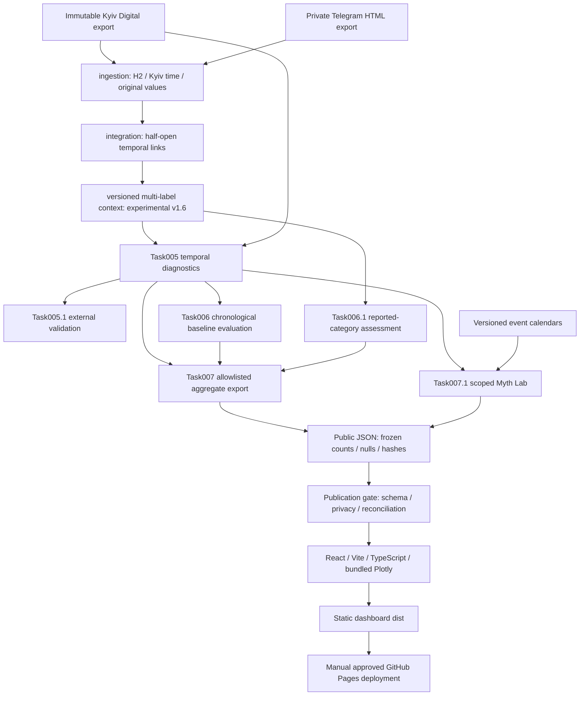

# Current architecture

The repository contains two workflows: offline reproducible research requiring
retained private inputs, and a static dashboard that works from a fresh checkout
using committed aggregates. No backend/API/database/live forecast/chat service.
The original Task001-only exclusions were superseded by explicit user Tasks007
and007.1 for the static research presentation.

## Implemented components

- `ingestion`, `integration`, `classification`, `attribution`,
  `classification_v14/v15/v16`: frozen source/context pipelines and review profiles.
- `temporal_analysis`, `external_validation`, `forecastability`,
  `threat_forecastability`: completed retrospective experiments/reports. Model
  validation found no demonstrated stable operational gain; no deployed predictor.
- `myth_lab`: separate descriptive computations from frozen data/calendars.
- `scripts/export_dashboard_data.py`: presentation aggregation only.
- `dashboard/`: core six sections plus Myth Lab; separate loaders so Myth Lab
  failures do not erase the core. Hash navigation and repository base path.
- `dashboard/scripts/check-data.mjs`: dependency-free Node publication gate;
  verifies public assets/checksums/multi-label counts/holdout reconciliation and
  report provenance without requiring private data.
- `analysis/`, `forecasting/`: old placeholder packages, not active implementations;
  use the actual modules listed above.

## Publication boundary

Raw/interim/processed/external inputs stay local and ignored. Retained research
reports and authorized historical human-review archives are versioned in Git;
review files may contain source excerpts and are not served by Pages. Only
`dashboard/dist` is uploaded. Fifteen aggregate JSON files are bundled, without
source texts/individual message IDs/machine paths. Unknown/null stays unknown.
Build must fail for unexpected public assets, source fields or checksum drift.

CI on push/PR has read-only repository permissions and cannot deploy. Pages uses
manual dispatch; only the deploy job obtains Pages/id-token write permissions.
Research-lead approval and owner activation remain prerequisites. Tests/build
read saved results, not a live source. Runtime processes must restart after cloud
restoration. `npm ci` uses a lockfile; Python's retained analysis environment uses
four versioned locks. Full historical regeneration requires the original workspace.
