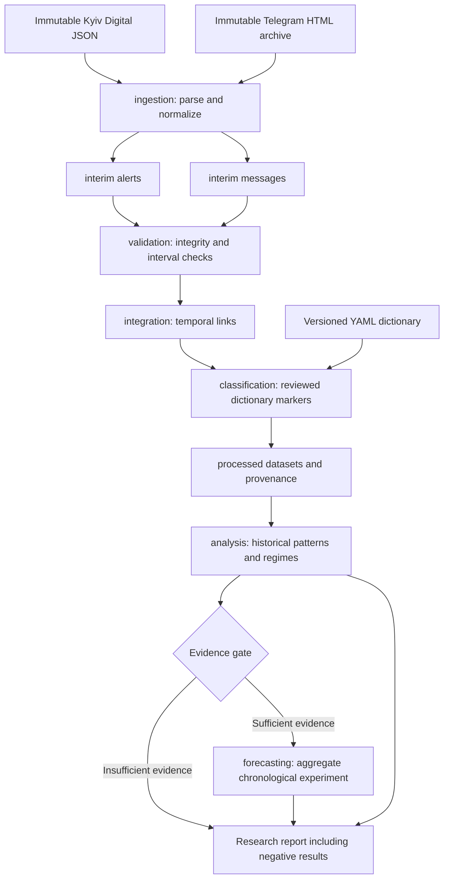

# Architecture

Use ordinary Python modules and local files. The workload is historical research with two supplied exports; a web application, API, database server, cloud infrastructure, and agent orchestration would add complexity without serving Task 001. The diagram describes the full planned flow. Source ingestion and data-quality checks are implemented (Tasks 002/002.1); temporal integration and descriptive coverage are implemented (Task 003). Classification, research analysis and forecasting remain future stages.

## Responsibilities
- `ingestion`: implemented source parsing/normalization, preserving original evidence and coverage metadata.
- `integration`: implemented half-open interval/message mapping with an indexed sweep, retaining separate message records and unresolved-case evidence. The CLI verifies H2 inputs and produces links/coverage Parquet plus JSON/Markdown reports.
- `classification`: Task 004 v1.0 dictionary candidates, conservative context/geography aggregation, provenance, diagnostics and blank-label review sampling; semantic validation pending.
- `validation`: implemented ingestion integrity and source-time verification; integration validates link membership, foreign keys, source provenance and count reconciliation. Classification validation remains future work.
- `analysis`: future descriptive/inferential time-series and stability work.
- `forecasting`: optional aggregate evaluation after research approval; no operational prediction.

## Layers and reproducibility
`data/raw/` stores immutable source copies; `data/interim/` holds normalized alerts and messages; `data/processed/` holds separate `alert_message_links.parquet` and one-row-per-alert `alert_coverage.parquet`, plus Task 004 `message_threat_markers.parquet` and `alert_threat_features.parquet`; later analysis datasets remain deferred. All contents are ignored except placeholders. `config/` versions the Task 004 v1.0 taxonomy and provisional dictionary rules; `docs/` versions research assumptions. Notebooks are exploratory consumers of reusable modules, not the only implementation location. `scripts/` is reserved for future portable entry points; `reports/` holds ignored generated artifacts.

Future runs must record input hashes, source IDs/files, dictionary/config versions, code revision, package versions, deterministic settings where relevant, and validation results. Derived records must trace to alert/message evidence. `requirements-dev.lock.txt` records tested ingestion/integration dependency versions. Each CLI reports package versions and input SHA-256 hashes; outputs can be compared logically across repeated runs. Local installation uses the src layout and setuptools. No runtime service startup is needed.
